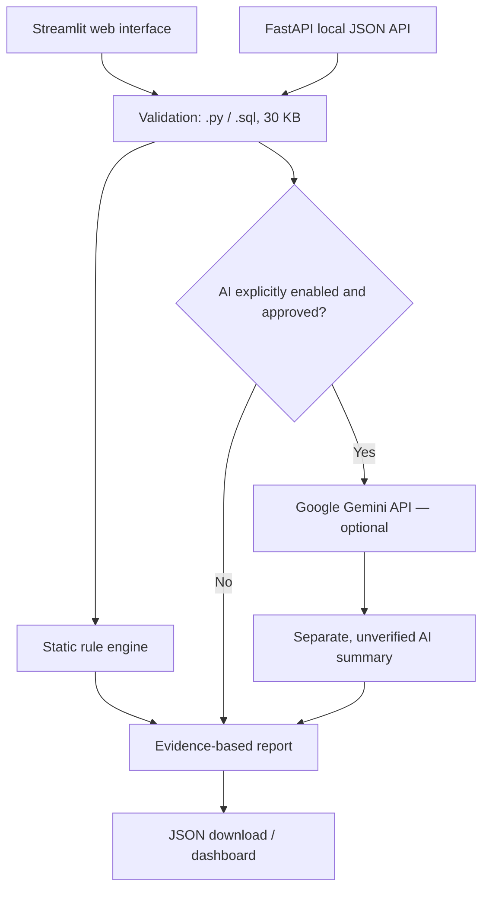

# GuardAI Sentinel

**AI-assisted AppSec & Data Engineering Code Review — an evidence-first portfolio MVP**

> **Status:** runnable local-first MVP. Python/SQL static analysis, a Streamlit dashboard, optional Gemini review, a FastAPI JSON API, unit/API tests and a small reproducible benchmark. LLM integration requires a personal key and has **not** been live-tested in this deliverable.

**Live demo (Streamlit Community Cloud):** [Open GuardAI Sentinel](https://guardai-sentinel-sjpa8g326gtpaywtttcp8c.streamlit.app/)

The public demo uses **static scanning only** by default. Gemini review remains opt-in and disabled in the hosted environment unless explicitly configured. The repository owner verified the deployed UI with two browser smoke tests (vulnerable and parameterized Python examples). See [public demo validation](docs/PUBLIC_DEMO_VALIDATION.md). The hosted app has not been independently audited.

## Why this project exists

Security reviews often mix unverified model guesses with actual evidence. GuardAI Sentinel separates **deterministic findings** from **optional LLM suggestions**, provides source locations, documents uncertainty and forbids execution of uploaded code. It extends the ideas of [GuardAI, the DIO/Santander cybersecurity lab](https://github.com/MariMecucci/guardai-cybersecurity-agent) into a standalone AI engineering product.

The scanner is **not** a production SAST replacement. It detects a limited set of teaching patterns and can produce false positives and false negatives.

## Demo capabilities

- **Streamlit:** upload `.py` or `.sql`, select demo samples or paste code, view findings and download JSON.
- **Python static rules:** AST-based indicators of dynamic SQL construction and `subprocess(..., shell=True)`.
- **SQL static rules:** suspicious template placeholders in query files; not a SQL parser.
- **Evidence:** rule IDs, line references, confidence, explanation, mitigation and authoritative links.
- **Optional AI:** Google Gemini can generate a Portuguese-language contextual summary; output is **clearly separate** from verified rule findings.
- **FastAPI:** `/health` and `/analyze` JSON endpoints for local integration.
- **Testing:** deterministic unit/API tests plus a hand-labeled synthetic evaluation dataset.
- **Free-first:** all local static functionality works without an API key or paid services.

## Architecture



**Trust boundary:** files are treated as untrusted **text**. The app does not `exec`, `eval`, import or run code from users. AI review sends the source to Google only after an explicit opt-in. Public AI access is disabled by default to avoid exhausting quotas or exposing third-party code.

## Run locally (Windows / PowerShell)

```powershell
py -m venv .venv
.\.venv\Scripts\Activate.ps1
python -m pip install -r requirements.txt
streamlit run streamlit_app.py
```

If PowerShell blocks activation, use `.venv\Scripts\python.exe -m pip install -r requirements.txt` followed by `.venv\Scripts\python.exe -m streamlit run streamlit_app.py` without changing system execution policy.

On macOS/Linux, activate via `source .venv/bin/activate` and use `python3`.

### Command-line analysis (no dependencies)

```powershell
py -m sentinel.cli examples/vulnerable_login.py
py -m sentinel.cli examples/secure_login.py
```

### FastAPI (local integration)

```powershell
uvicorn sentinel.api:app --reload --host 127.0.0.1 --port 8000
```

Then visit `http://127.0.0.1:8000/docs`. Example request:

```json
{
  "filename": "safe.py",
  "source": "cursor.execute('SELECT id FROM users WHERE id=?', (user_id,))",
  "use_ai": false
}
```

Do **not** expose the API publicly without authentication, rate limiting, TLS and abuse controls.

## Optional Gemini (local-only recommended)

1. Create a **personal** Gemini API key in [Google AI Studio](https://aistudio.google.com/apikey). Google offers a free tier for supported models, subject to quotas and policies; free-tier submitted content may be used to improve its products. Read the [official pricing and data policy](https://ai.google.dev/gemini-api/docs/pricing/) first.
2. Never paste the key into ChatGPT, GitHub, commits or screenshots.
3. Set environment variables in your local session (do not commit these):

```powershell
$env:GEMINI_API_KEY = "PASTE_YOUR_KEY_LOCALLY_ONLY"
$env:GEMINI_MODEL = "gemini-2.5-flash-lite"
$env:GUARDAI_ENABLE_AI = "1"
streamlit run streamlit_app.py
```

4. In the interface, check **Solicitar revisão Gemini**, then explicitly accept sending your **synthetic or authorized** source code to Google.
5. The app includes an AI failure fallback to static findings. An API key is not needed for CI or tests. Model availability, SDK compatibility and rate limits should be verified when enabling Gemini.

**Security note:** do not upload private company code, credentials or PII to a public/free AI endpoint. No automated secret scrubber can guarantee removal of all sensitive data. Do not publish a public app with your own Gemini key enabled unless you've added identity, quotas, abuse controls and data handling consent.

## Evaluation: measured, not invented

Run tests:

```powershell
py -m unittest discover -s tests -v
py -m sentinel.evaluate --output docs/benchmark-results.json
```

The local prototype passed **22 automated unit/integration tests** in the authoring environment. The baseline scanner was evaluated on **32 hand-labeled synthetic snippets**, yielding:

| Metric | Measured result |
| --- | ---: |
| TP / FP / TN / FN | 17 / 1 / 11 / 3 |
| Precision | 0.9444 |
| Recall | 0.8500 |
| F1 | 0.8947 |

The synthetic dataset is deliberately tiny and includes known unsupported patterns. These results **do not** represent real-world detection performance, AI accuracy or security guarantees. See [Evaluation methodology](docs/EVALUATION.md) and the reproducible [JSON result](docs/benchmark-results.json).

## Scope and known limitations

- Only `.py` and `.sql` text, max **30 KB** and **600 lines**.
- Python AST checks only selected patterns. A clean report does not mean safe code.
- Dynamic `str.format`, `%` interpolation, taint propagation and inter-file flow are not fully handled.
- SQL template detection is heuristic; SQL syntax varies by engine.
- Severity is rule-level triage, not an environment-specific CVSS score.
- The MVP is **not RAG** and **not a multi-agent system**. Those are planned extensions.
- No user accounts, permanent upload storage or code execution.

## Repository structure

```text
sentinel/
  models.py       # typed report structures
  static.py       # local AST and SQL checks
  service.py      # shared orchestration
  ai.py           # optional Gemini review
  api.py          # FastAPI application
  cli.py          # CLI
  evaluate.py     # benchmark runner
streamlit_app.py  # web app
examples/         # synthetic samples and labeled benchmark
  benchmark_cases.json
tests/            # automated unit and API tests
docs/             # methodology, security and roadmap
.github/workflows/test.yml
```

## Deployment

The **Streamlit** app is designed to run on [Streamlit Community Cloud](https://share.streamlit.io/): select the GitHub repo and `streamlit_app.py` as the entrypoint. **Keep `GUARDAI_ENABLE_AI=0`** for a public demo by default. Deployment requires linking your GitHub account to Streamlit; that external authorization is not performed by this repository.

## Roadmap

**MVP (implemented):** static scanning, UI, optional LLM adapter, local API, benchmark and CI configuration.

**Next:** private evaluation of Gemini responses, OWASP-referenced RAG with citation checks, SQL dialect-aware analysis, stronger taint detection, abuse controls and CI-based quality gates. See [ROADMAP](docs/ROADMAP.md).

## Credits

Created as an independent portfolio continuation of [GuardAI — DIO/Santander Cybersecurity](https://github.com/MariMecucci/guardai-cybersecurity-agent). Educational synthetic samples only. Related references: [OWASP SQL Injection Prevention](https://cheatsheetseries.owasp.org/cheatsheets/SQL_Injection_Prevention_Cheat_Sheet.html) · [OWASP Top 10](https://owasp.org/www-project-top-ten/) · [Python AST](https://docs.python.org/3/library/ast.html).

---

### Resumo em português

O GuardAI Sentinel é um produto de portfólio com **scanner estático de Python/SQL**, dashboard Streamlit, API FastAPI e **revisão opcional via Gemini**. A análise local não usa créditos de IA. O projeto inclui testes automatizados, um benchmark sintético reproduzível e documentação de riscos e limitações. É um demonstrador educacional, não uma auditoria profissional nem uma ferramenta de exploração.
